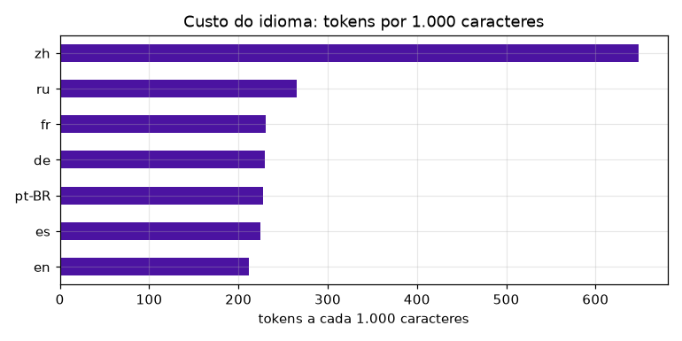
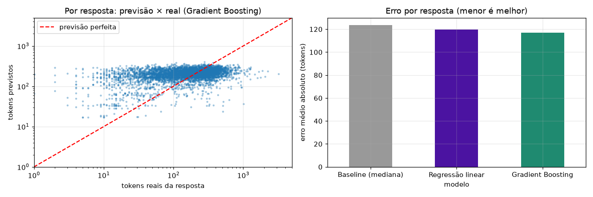

# Quanto custa usar IA dentro de uma aplicação?

Atividade de IA aplicada e IA experimental (Prof. Wagner, 3º ciclo).

O uso de IA generativa numa aplicação é medido e cobrado em **tokens**. Este projeto usa conversas reais e públicas para **prever quantos tokens o modelo vai gerar** e **estimar o custo mensal** de uma aplicação com IA.

Tudo está no notebook [`atividade_tokens_ia.ipynb`](atividade_tokens_ia.ipynb), já executado, com código, gráficos e explicação.

## Roteiro da atividade

| Etapa | No projeto |
|---|---|
| **Entender o problema** | A aplicação conhece o prompt, mas não sabe o tamanho da resposta, que é a parte mais cara. Quanto vai custar por mês? |
| **Base de dados** | [OpenAssistant oasst1](https://huggingface.co/datasets/OpenAssistant/oasst1) (Apache 2.0): ~88 mil mensagens reais, 18.924 pares prompt → resposta. Tokens contados com o tokenizador público `o200k_base` (`tiktoken`). |
| **Técnica** | Inferir os tokens da resposta a partir do prompt, comparar com um baseline e avaliar o impacto no custo. |
| **Família de algoritmos** | Aprendizado supervisionado, **regressão** (regressão linear × Gradient Boosting × baseline), e **simulação de Monte Carlo** para o custo. |
| **Validação** | Treino/teste 75/25, comparação com baseline, faixa de confiança por simulação e limitações listadas. |
| **Resultado explicado** | Seção 8 do notebook. |

## Resultados

| Modelo | R² (log) | Erro médio por resposta | Total previsto / real |
|---|---|---|---|
| Baseline (mediana) | -0,03 | 124 tokens | 0,997 |
| Regressão linear | 0,12 | 120 tokens | 1,038 |
| Gradient Boosting | 0,15 | 117 tokens | 1,022 |

- **Uma resposta isolada é difícil de prever** (R² ≈ 0,15): o tamanho depende do conteúdo, não só do tamanho da pergunta.
- **O custo do mês é previsível**: para 10 mil requisições, a estimativa fica a ~2% do real. Mas a média histórica (baseline) chega no mesmo resultado. O que importa para o orçamento é medir uma amostra real de uso.
- **A saída é ~97% do custo**: em mediana, a resposta tem ~10 vezes mais tokens que o prompt, e o token de saída é mais caro. Limitar o tamanho das respostas é a maior economia.
- **O idioma muda o custo**: português gasta ~7% mais tokens por caractere que inglês.






## Como rodar

```bash
python3 -m venv .venv
.venv/bin/pip install -r requirements.txt
```

Abra `atividade_tokens_ia.ipynb` no VS Code ou no Jupyter e rode todas as células. A base (~34 MB) é baixada automaticamente para `data/raw/` na primeira execução. `data/pares_prompt_resposta.csv` guarda os pares já processados.

Os preços por token no notebook (`PRECO_ENTRADA`, `PRECO_SAIDA`) são exemplos editáveis.
