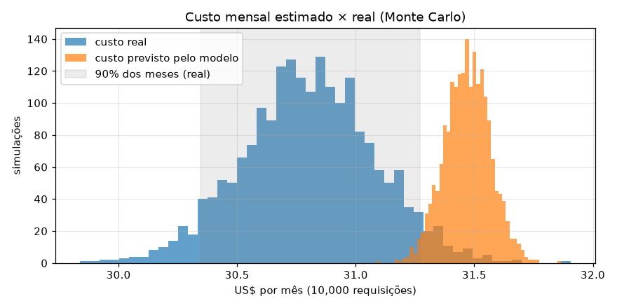

# TokenScope: quanto custa a IA da sua aplicação?

Atividade de IA aplicada e IA experimental (Prof. Wagner, 3º ciclo).

Uma aplicação com IA generativa paga por **token**. Ela conhece o prompt que envia, mas **não sabe o tamanho da resposta**, que é a parte mais cara. O **TokenScope** é uma dashboard web que:

1. **prevê** quantos tokens a IA vai gerar para um prompt, com uma faixa de incerteza, usando um modelo treinado com 18.924 conversas reais;
2. **calcula o custo** por requisição e por mês, e quanto se economiza limitando o tamanho da resposta;
3. **executa o prompt no Gemini** pela API e compara a previsão com os tokens reais que a API informa, acumulando um histórico de acerto.

## Roteiro da atividade

| Etapa | No projeto |
|---|---|
| **Entender o problema** | Planejar o custo de usar IA dentro de uma aplicação sem saber o tamanho das respostas. |
| **Base de dados** | [OpenAssistant oasst1](https://huggingface.co/datasets/OpenAssistant/oasst1) (Apache 2.0): ~88 mil mensagens reais, 18.924 pares prompt → resposta. |
| **Técnica** | Inferir os tokens da resposta, comparar com um baseline e avaliar o impacto no custo. |
| **Família de algoritmos** | Aprendizado supervisionado, **regressão**: Gradient Boosting, regressão quantílica (faixa de 80%), regressão linear e baseline. **Monte Carlo** para o custo mensal. |
| **Token de IA** | O app usa a API do Gemini. Cada execução gasta tokens reais, que são medidos e comparados com a previsão. |
| **É válido?** | Treino/teste 75/25, comparação com baseline, cobertura da faixa de 80% e validação ao vivo contra o Gemini. |
| **Resultado explicado** | Aba "O modelo é válido?" do app e seção 8 do notebook. |

## Resultados

| Modelo | R² (log) | Erro médio por resposta | Total previsto / real |
|---|---|---|---|
| Baseline (mediana) | -0,03 | 124 tokens | 0,997 |
| Regressão linear | 0,12 | 120 tokens | 1,038 |
| Gradient Boosting | 0,15 | 117 tokens | 1,022 |

- **Uma resposta isolada é difícil de prever** (R² ≈ 0,15): o tamanho depende do conteúdo, não só do tamanho da pergunta.
- **O custo do mês é previsível**: para 10 mil requisições, a estimativa fica a ~2% do real. A média histórica (baseline) chega no mesmo total, então o que importa para o orçamento é medir uma amostra real de uso.
- **A saída domina o custo**: em mediana, a resposta tem ~10 vezes mais tokens que o prompt, e o token de saída é mais caro.
- **O idioma muda o custo**: português gasta ~7% mais tokens por caractere que inglês.

## Estrutura

| Arquivo | O que é |
|---|---|
| `app.py` | Dashboard (Streamlit) |
| `core/modelo.py` | Treino e previsão do modelo, custo e economia |
| `core/ia.py` | Chamadas ao Gemini e calibração de tokens |
| `atividade_tokens_ia.ipynb` | Análise completa, executada, com gráficos e explicação |
| `preparar_dados.py` | Gera os arquivos auxiliares de `data/` |
| `data/` | Pares processados, tokens por idioma e amostra de calibração |
| `figures/` | Gráficos do notebook |

## Como rodar

```bash
python3 -m venv .venv
.venv/bin/pip install -r requirements.txt
.venv/bin/streamlit run app.py
```

A API key do Gemini pode ser colada na barra lateral do app ou definida em `.streamlit/secrets.toml` (fora do git):

```toml
GEMINI_API_KEY = "sua-chave"
GEMINI_MODEL = "gemini-2.5-flash"  # opcional
```

Para abrir o notebook: `.venv/bin/pip install ipykernel` e abra `atividade_tokens_ia.ipynb` no VS Code ou no Jupyter.

## Publicar no Streamlit Community Cloud

1. Em [share.streamlit.io](https://share.streamlit.io), entre com o GitHub e clique em **Create app**.
2. Escolha este repositório, a branch `main` e o arquivo `app.py`.
3. Em **Advanced settings → Secrets**, cole `GEMINI_API_KEY = "sua-chave"`.
4. Clique em **Deploy**.

Com a chave do servidor, cada visitante tem até 20 chamadas ao Gemini por sessão. Quem colar a própria chave na barra lateral não tem esse limite.



